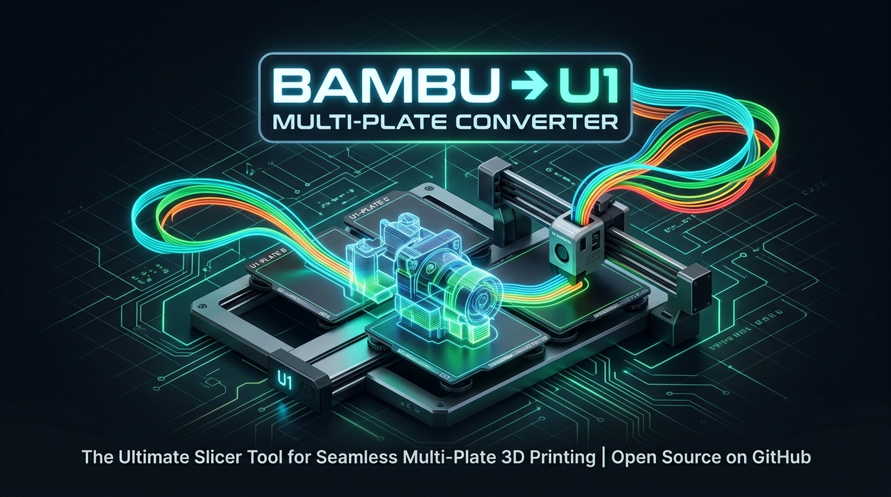

<p align="center">
  
</p>

# ⚡ Bambu2U1 Multi-Plate Converter

[](https://github.com/bradhoschar/Bambu2U1_MultiPlate/releases/latest)
[](https://github.com/bradhoschar/Bambu2U1_MultiPlate/releases)
[](https://opensource.org/licenses/MIT)

> Convert **Bambu Studio / MakerWorld multi-plate 3MF files** into individual, 100% compatible **Snapmaker U1-ready** projects — preserving multi-color painting, material thermal profiles, auto-centering on the U1 build plate, and eliminating prime tower layer height conflicts.

Inspired by [bl2u1](https://bl2u1.nbn.cat/) (created by [josuanbn](https://github.com/josuanbn)), but built specifically to support **multi-plate projects with 12+ total colors across plates** (such as statues, dioramas, and multi-part assemblies).

---

> [!IMPORTANT]
> **Pre-Processor for Snapmaker Orca:** Bambu2U1 is a pre-processor, not a slicer replacement. It fixes MakerWorld canvas offsets, strips prime-tower conflicts, and translates Bambu project files into clean Snapmaker U1 `.3mf` files ready to slice.

### 🎨 Hardware Color Limits (Important Distinction)
* The Snapmaker U1 has **4 physical spool slots / toolheads**. Bambu2U1 does **not** bypass hardware limits to print 12 colors on a single plate.
* Instead, it supports **multi-plate projects containing 12+ total colors** by isolating each plate independently. Each individual plate uses up to 4 colors and maps them cleanly into U1 Slots 1–4.

| Plate | Original Bambu Colors Used | Exported U1 Slots (Filaments to load for print) |
| :--- | :--- | :--- |
| **Plate 1 (Head & Mask)** | Yellow, Black, White, Blue | Slot 1: Yellow, Slot 2: Black, Slot 3: White, Slot 4: Blue |
| **Plate 2 (Base & Claws)** | Silver, Red, Dark Grey, Gold | Slot 1: Silver, Slot 2: Red, Slot 3: Dark Grey, Slot 4: Gold |

*Between plate print jobs, simply load the 4 spools matching that plate's slot assignments.*

---

## 🌟 Why Bambu2U1 Multi-Plate?

| Feature | Original bl2u1 | **Bambu2U1 Multi-Plate (v1.1)** |
| :--- | :---: | :---: |
| **Single-plate files** | ✅ | ✅ |
| **Multi-plate projects (e.g. 11 plates)** | ❌ (1 plate only) | ✅ **Full multi-plate support** |
| **Projects with 4+ total colors** | ❌ (Truncates to 4) | ✅ **Intelligent per-plate mapping** |
| **Preserves PETG/TPU/ABS Thermals & Speeds** | ❌ (Forced to generic PLA) | ✅ **Exact source temps & volumetric flows** |
| **Plate Centering on U1 Bed** | ❌ (Off-plate crash) | ✅ **Dynamic bounding-box centroid math** |
| **Mesh Facet & Sub-part Painting Remap** | ❌ | ✅ **Full `paint_color` token remapping** |
| **Fix Prime Tower Layer Conflict** | ❌ (Slicer error) | ✅ **Automatic conflict stripping** |
| **Layer Pauses & Height Swaps** | ❌ (Dropped) | ✅ **Preserves `custom_gcode_per_layer.xml`** |
| **Interactive Visual Web UI** | ✅ | ✅ **Modern dark UI + plate previews** |
| **CLI / Drag-and-Drop Batch Mode** | ❌ | ✅ **1-Click Windows Batch & Python CLI** |
| **Docker Support** | ✅ | ✅ **Full Docker & Compose support** |

---

## 🚀 Quick Start

### 1. Windows Standalone (No Python or Setup Required)
1. Download **`Bambu2U1_v1.1.0_Windows.zip`** from [Releases](https://github.com/bradhoschar/Bambu2U1_MultiPlate/releases).
2. Extract the folder anywhere.
3. Double-click **`Bambu2U1_Converter.exe`** (or `Start_Web_UI.bat`) to launch the web dashboard.
4. Drag & drop any `.3mf` file directly to convert all plates.

### 2. Run with Python
```bash
# Clone the repository
git clone https://github.com/bradhoschar/Bambu2U1_MultiPlate.git
cd Bambu2U1_MultiPlate

# Install dependencies
pip install -r requirements.txt

# Start the Web UI
python app.py
```
Open your browser to `http://localhost:5000`.

### 3. Command Line Interface (CLI)
Convert multi-plate 3MF files directly in your terminal:
```bash
python converter.py "C:\path\to\Wolverine.3mf" -o "./output_folder"
```

### 4. Docker / Self-Hosting
Run as a Docker container:
```bash
docker-compose up -d
```
Or build directly:
```bash
docker build -t bambu2u1 .
docker run -d -p 5000:5000 --name bambu2u1 bambu2u1
```

---

## ⚙️ How It Works Under The Hood

1. **Plate Discovery & Parsing**: Reads `Metadata/model_settings.config` and `3D/3dmodel.model` to identify every build plate, part, coordinate, and color swatch.
2. **Per-Plate Filament Allocation**: Detects which specific colors are used on each individual plate (typically 1 to 4) and remaps them cleanly into Snapmaker U1 slots 1–4.
3. **Thermal & Flow Preservation**: Extracts nozzle temperatures, bed temperatures, cooling fan curves, and volumetric flow limits from the source materials (PETG, TPU, PLA) and maps them to the respective U1 slots.
4. **Dynamic Bed Centering**: Calculates the dynamic bounding box centroid of all objects on each plate and translates them to the center of the Snapmaker U1's 270×270mm bed coordinate space.
5. **Facet Paint Remapping**: Re-indexes vertex and facet color assignment tokens (`paint_color`) so multi-color mesh paint jobs align with the converted 4-slot layout.
6. **Prime Tower Cleanup**: Strips incompatible global variable layer height curves (`layer_heights_profile.txt`) that cause OrcaSlicer prime tower slicing conflicts.
7. **Snapmaker U1 Machine Profile Injection**: Applies Snapmaker U1 hardware limits, printable envelope (`0.5x1` to `270.5x271`), and start/end G-code definitions.

---

## 📦 Project Structure

```text
├── app.py                   # Flask Web Server & REST API
├── converter.py             # Core multi-plate conversion engine
├── templates/
│   ├── index.html           # Modern dark-mode Web UI
│   ├── u1_template.3mf      # Official Snapmaker U1 base profile
│   └── u1_template_supports.3mf # Snapmaker U1 tree-support profile
├── Convert_To_U1.bat        # Windows drag-and-drop batch converter
├── Start_Web_UI.bat         # Windows web UI launcher
├── requirements.txt         # Python dependencies (Flask, gunicorn)
├── Dockerfile               # Production container image
├── docker-compose.yml       # Docker compose orchestration
├── LICENSE                  # MIT License
└── README.md                # Documentation
```

---

## 📄 License
MIT License. Free to use, modify, and distribute for the 3D printing community.
